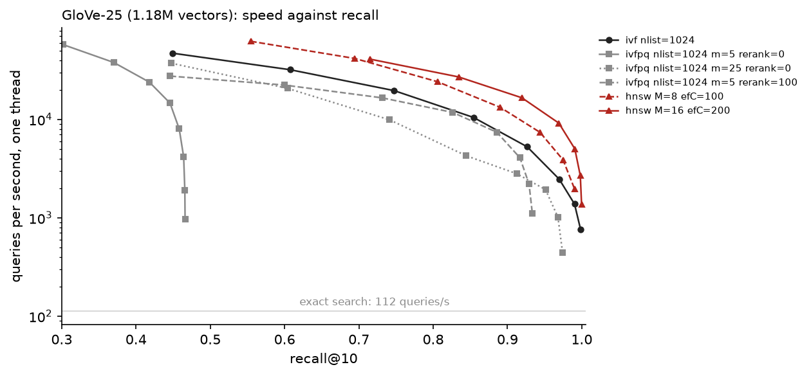

# Vector search from scratch: IVF, IVF-PQ and HNSW in C++

Approximate nearest-neighbour search, the retrieval step behind semantic search and
recommendations. The indexes are written from the papers in header-only C++20, with no
dependencies:

- exact search;
- IVF, which clusters the vectors with k-means and scans only the nearest lists;
- IVF-PQ, which adds product quantization;
- HNSW, the hierarchical navigable small-world graph.

Each is benchmarked the way ann-benchmarks does it: recall@10 against queries per second,
with one thread, on GloVe-25. That is 1,183,514 word vectors, 10,000 queries, and the
published true neighbours.



## Results

| index | build (s) | size (MB) | queries/s at recall ≥ 0.90 | ≥ 0.95 | ≥ 0.99 |
|---|---|---|---|---|---|
| exact | 0 | 118 | 112 (recall 1.0) | | |
| IVF, 1,024 lists | 32 | 123 | 5,264 | 2,473 | 1,378 |
| IVF-PQ, 5 bytes per vector | 48 | 11 | not reached (peaks at 0.47) | | |
| IVF-PQ, 25 bytes per vector | 61 | 34 | 2,801 | 1,932 | not reached |
| IVF-PQ, 5 bytes, rerank 100 | 46 | 11 (+118 for reranking) | 4,078 | not reached (peaks at 0.93) | |
| HNSW, M=8, efConstruction 100 | 107 | 204 (graph + vectors) | 7,390 | 3,875 | 1,959 |
| HNSW, M=16, efConstruction 200 | 283 | 279 (graph + vectors) | **16,581** | **9,166** | **5,019** |

Each row is the fastest setting that reaches the recall (nprobe for IVF, ef for HNSW).

- **HNSW wins on speed against recall.** At 0.99 recall it answers 5,019 queries a second:
  3.6 times IVF and 45 times exact search. The cost is a build nearly nine times longer
  than IVF's, and about 160 MB of graph on top of the vectors.
- **Graph degree matters.** Doubling M from 8 to 16 makes queries 2.2 to 2.6 times
  faster at the same recall, for a 2.6-times longer build.
- **Product quantization trades recall for memory.** Five bytes per 25-dimensional vector
  (from 100) shrink the index to 11 MB, but recall stops at 0.47, because the codes cannot
  tell close neighbours apart. Two fixes:
  - re-scoring the top 100 candidates with the original vectors lifts recall to 0.93, but
    needs those vectors in memory;
  - 25-byte codes reach 0.97 without them.

  That is the trade-off behind every billion-scale index.
- **Normalising for cosine.** GloVe uses angular distance. Scaling every vector to unit
  length makes Euclidean nearest neighbours equal cosine nearest neighbours. The prepare
  script checks this: exact search on the normalised vectors reproduces the published
  top 10 for all of 200 sampled queries.

Measured on an Apple M4 Pro, one thread, while the machine was also training a model on its
GPU. Raw numbers: `results/bench.csv`.

## How each index works

- **IVF** (`include/vs/ivf.hpp`):
  - k-means (Lloyd, 20 iterations on 200,000 sampled vectors) gives 1,024 centroids;
  - each vector is stored in the list of its nearest centroid;
  - a query scans the `nprobe` nearest lists exactly.
- **IVF-PQ** (Jégou, Douze and Schmid, 2011):
  - the residual (vector minus its list centroid) is cut into m sub-vectors;
  - each sub-vector is replaced by the index of the nearest of 256 sub-centroids, one byte
    each;
  - a query precomputes an m × 256 table of distances from its own residual to every
    sub-centroid, so each stored vector costs m table lookups (asymmetric distance);
  - an optional rerank re-scores the best candidates with exact distances.
- **HNSW** (Malkov and Yashunin, 2018) (`include/vs/hnsw.hpp`):
  - **Layers:** each vector draws a top layer with probability falling geometrically, and
    links to up to M neighbours per layer (2M on layer 0).
  - **Neighbour choice:** neighbours come from the paper's heuristic (Algorithm 4). A
    candidate is kept only if it is closer to the new node than to any neighbour already
    kept, which spreads links in different directions.
  - **Search:** a query walks greedily down the upper layers, then runs a best-first search
    on layer 0 with a candidate list of size ef.
  - **Memory layout:** layer-0 links sit in one flat array for cache locality.

## Tests

`make test` runs 12 tests on small clustered data:

- top-k against a full sort;
- k-means inertia never rising;
- IVF probing all lists equal to exact search, and recall rising with nprobe;
- PQ's table distance equal to the distance to the decoded vector, and codes nearest per
  sub-space;
- IVF-PQ with all lists and full rerank equal to exact search, and compression costing
  recall that rerank wins back;
- HNSW recall ≥ 0.98, recall rising with ef;
- HNSW degree limits on every layer, every node reachable on layer 0, and identical
  results from two builds with the same seed.

`make sanitize` runs them under AddressSanitizer and UndefinedBehaviorSanitizer. The build
uses `-Wall -Wextra -Wpedantic -Wconversion -Werror`.

## Run it

```
make test
uv venv && uv pip install h5py numpy matplotlib
curl -o data/glove-25-angular.hdf5 http://ann-benchmarks.com/glove-25-angular.hdf5   # 121 MB
.venv/bin/python scripts/prepare.py data/glove-25-angular.hdf5 data/glove-25
make && ./scripts/run_bench.sh                 # about half an hour
.venv/bin/python scripts/plot.py results/bench.csv
```

## Limits

- **One thread,** both for search (as ann-benchmarks measures) and for build.
- **Scalar distances.** No SIMD beyond what the compiler does on its own.
- **HNSW is insert-only.** No deletions or updates.
- **One dataset.** Higher-dimensional sets (SIFT-128, 500 MB) would test the
  memory-bandwidth side more.

## Sources

- Malkov, Y. A. and Yashunin, D. A. (2018). Efficient and robust approximate nearest neighbor
  search using hierarchical navigable small world graphs. IEEE TPAMI 42(4).
- Jégou, H., Douze, M. and Schmid, C. (2011). Product quantization for nearest neighbor
  search. IEEE TPAMI 33(1).
- Aumüller, M., Bernhardsson, E. and Faithfull, A. (2020). ANN-Benchmarks. Information
  Systems 87. Data: <http://ann-benchmarks.com/glove-25-angular.hdf5>.
- Pennington, J., Socher, R. and Manning, C. D. (2014). GloVe: Global vectors for word
  representation. EMNLP.
